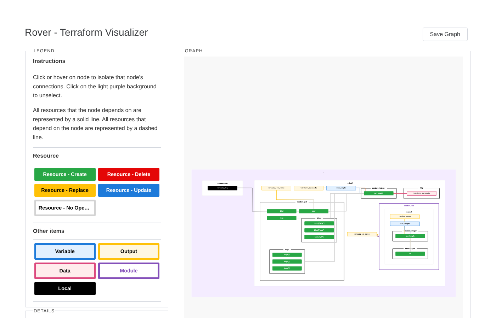
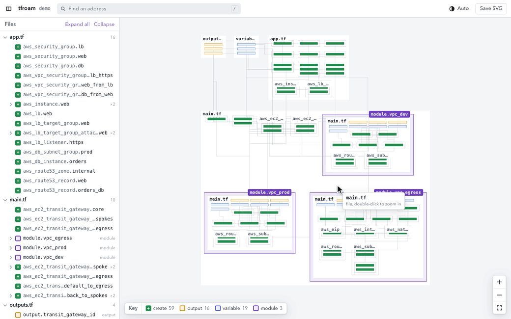
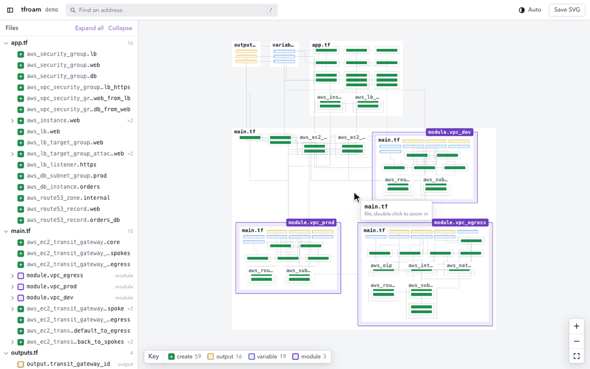
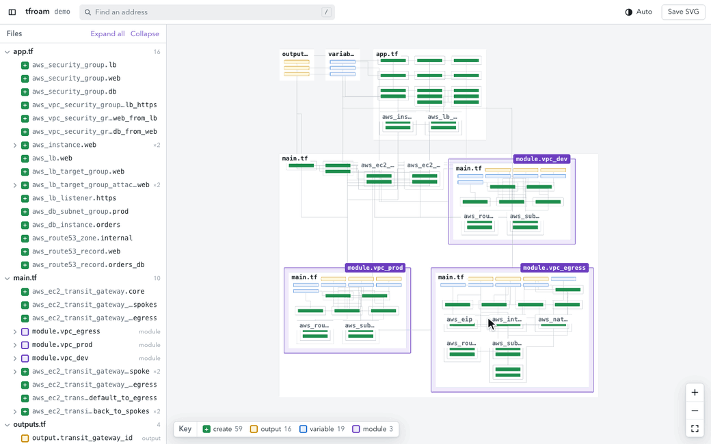

# tfroam

**tfroam** is an interactive [Terraform](https://www.terraform.io/) visualizer: a Python port of
[im2nguyen/rover](https://github.com/im2nguyen/rover). The Go backend is rewritten in Python and produces
the same documents; the web page is Rover's Vue frontend, reworked to stay usable on plans with hundreds
of resources (see [Using the page](#using-the-page)).

The package and the command are both `tfroam`. (The command used to be `rover`, as in the original; that
name is gone, see [Differences from the Go version](#differences-from-the-go-version).)

tfroam:

1. runs `terraform init` and `terraform plan` (or reads a plan you give it) and parses the `.tf`
   configuration in the working directory,
2. builds three documents from them: the resource overview (`rso`), the module/file map (`map`) and the
   resource graph (`graph`),
3. serves an interactive configuration and state visualization on `127.0.0.1:9000`, writes a standalone
   `tfroam.zip`, or saves the graph as an SVG. It can also open every `terraform plan` you run
   automatically ([Open plans automatically](#open-plans-automatically)).

<picture>
  <source media="(prefers-color-scheme: dark)" srcset="docs/screenshot-dark.png">
  
</picture>

The screenshots and animations on this page use the made-up network in [`docs/demo`](docs/demo) (three VPC
modules, a transit gateway and a small web tier; it plans without an AWS account): `cd docs/demo && tfroam`.

**New to tfroam?** [docs/usage.md](docs/usage.md) walks through running it, reading the page, common tasks,
large plans, sharing, the keyboard and troubleshooting. This README is the reference.

## Install

tfroam needs **Python 3.11+** and a **Terraform** binary (unless you only visualize a plan file). It does
not need Docker, and the frontend is prebuilt, so it does not need Node either.

tfroam is not on PyPI yet, so install it from this repository. The easiest way is
[pipx](https://pipx.pypa.io/): it gives tfroam its own virtualenv and puts the `tfroam` command on your
`PATH` (in `~/.local/bin`):

```
$ brew install pipx                  # or: python3 -m pip install --user pipx
$ pipx ensurepath                    # adds ~/.local/bin to PATH; open a new terminal afterwards
$ pipx install git+https://github.com/CorpLynx/rover-python.git
$ tfroam -version
```

From a checkout, install the directory instead. `--editable` makes the command follow your checkout as you
change it:

```
$ git clone https://github.com/CorpLynx/rover-python.git && cd rover-python
$ pipx install --editable .
```

Without pipx, use a virtualenv and link the command into a directory that is already on your `PATH`:

```
$ python3 -m venv ~/.venvs/tfroam
$ ~/.venvs/tfroam/bin/pip install .                       # from the checkout
$ mkdir -p ~/.local/bin && ln -sf ~/.venvs/tfroam/bin/tfroam ~/.local/bin/tfroam
$ echo 'export PATH="$HOME/.local/bin:$PATH"' >> ~/.zshrc  # only if ~/.local/bin is not on PATH yet
```

(A link is better than adding the virtualenv's `bin` to `PATH`, which would also put its `python` and `pip`
ahead of your own.) Check it with `command -v tfroam` in a new terminal. The shell hook
([Open plans automatically](#open-plans-automatically)) runs `tfroam` in every new shell, so put it on
`PATH` before you add the hook.

To update: `pipx upgrade tfroam` (`pipx reinstall tfroam` when a git install has not changed version); an
`--editable` install follows `git pull`.

tfroam looks for `terraform` on your `PATH`. Use `-tfPath` to point at a specific binary.

### Image export (optional)

`-genImage` renders the page in a headless browser, which needs Playwright and a Chromium:

```
$ pipx inject tfroam playwright    # into the pipx install above (a virtualenv: pip install '.[image]')
$ playwright install chromium      # or set TFROAM_BROWSER_PATH to an existing Chrome/Chromium
```

## Quickstart

Run it in any Terraform working directory:

```
$ tfroam
2026/11/06 06:46:23 Starting tfroam...
2026/11/06 06:46:23 Initializing Terraform...
2026/11/06 06:46:24 Generating plan...
2026/11/06 06:46:25 Generating resource overview...
2026/11/06 06:46:25 Generating resource map...
2026/11/06 06:46:25 Generating resource graph...
2026/11/06 06:46:25 Done generating assets.
2026/11/06 06:46:25 tfroam is running on 127.0.0.1:9000
```

Then open <http://localhost:9000> (or add `-open` and tfroam opens it for you). Other directory?
`tfroam -workingDir example/eks-cluster`.

tfroam only listens on `127.0.0.1`. To reach it from another machine, ask for it explicitly with
`tfroam -ipPort 0.0.0.0:9000`. If `-ipPort` is given more than once, the last one wins.

Terraform's own output is captured and only shown if a command fails, so a long `init` can look stuck. Add
`-verbose` to watch `init`, `workspace select` and `plan` as they run (on stderr):

```
$ tfroam -verbose
```

### Using the page

The graph fills the window. The file and resource list is on the left; details open in a panel on the right.

- **Select:** click a resource, module, output or data source (in the graph or the list). Its details open,
  the things it depends on are joined to it by solid lines and the things that use it by dashed lines, and
  everything else fades. Click the background, press `Esc` or close the panel to clear. Moving the pointer
  over the graph only tints what is under it and shows its address; nothing else moves.
- **Find:** press `/` and type any part of an address (`nat_gateway`, `module.vpc_dev`, several words narrow
  it down). Matches are listed and outlined in the graph; `Enter` opens the first, the arrow keys walk the
  list.
- **Move around:** drag anywhere to pan (on a box or a resource too), scroll or pinch to zoom, double-click
  anything (a resource, a file, a module, a resource type) to zoom to it. The buttons in the corner zoom and
  fit the whole graph. "Show in graph" in the details panel brings the selected item into view at a readable
  size.
- **Read a big plan:** when the graph is zoomed out too far for its own labels, files, modules and resource
  types get small fixed-size labels instead, and the key along the bottom counts what the plan contains
  (`+` create, `~` update, `±` replace, `-` delete).
- **Details:** *Config* shows the block's arguments, with references you can follow; *Current* and *Proposed*
  show the state before and after (`known after apply` for values Terraform does not know yet, and a mark on
  values that change); *Connections* lists what the item depends on and what uses it.
- **Keyboard:** `Tab` reaches everything. In the list, the arrow keys move and open rows; with the graph
  focused, the arrow keys pan, `+`/`-` zoom and `0` fits.
- **Colours:** light or dark follows the system; the button next to "Save SVG" switches between auto, light
  and dark. Animations are skipped when the system asks for reduced motion.
- **Save SVG** downloads the whole graph as `tfroam.svg`, always in the original Rover style whatever is on
  screen (this is also what `-genImage` saves).

**Find an address.** Press `/` and type part of an address: matches are listed and outlined in the graph.
Open one, then follow a reference in its configuration to the resource it points at.



**Follow the dependencies.** Drag to pan, click a resource to see what it depends on (solid lines) and what
uses it (dashed), and walk from item to item through its references or the *Connections* tab. `Esc` clears.



**Zoom in and out.** Scroll to zoom where the pointer is, until the labels are readable; the fit button
brings the whole graph back, and a double-click zooms straight to one item.



The page loads nothing from the network: no CDN, fonts or analytics.

### Run on a Terraform plan file

Use `-planJSONPath` to visualize a plan without running Terraform (the binary is not needed):

```
$ terraform plan -out plan.out
$ terraform show -json plan.out > plan.json
$ tfroam -planJSONPath plan.json
```

Or give tfroam the binary plan with `-planPath plan.out`.

### Standalone mode

Writes `tfroam.zip` with every static asset; unzip it and open `index.html` straight from disk:

```
$ tfroam -standalone true
```

### Save an image

Writes `./tfroam.svg`, or the file named by `-imagePath`:

```
$ tfroam -genImage true
$ tfroam -genImage -imagePath docs/graph.svg
```

While it renders, image mode serves the page on a free port on `127.0.0.1`, so it works even when another
tfroam is already running on port 9000. Give `-ipPort` to choose the address yourself.

### Making a big graph easier to read

Almost every resource references a local or a variable, so those produce most of the lines. Hide them (and
every line touching them) with `-hide`; it works for the live view, `-standalone` and `-genImage`:

```
$ tfroam -hide locals,variables              # resources, modules and outputs
$ tfroam -hide locals,variables,outputs      # just resources and what depends on what
```

On a three-account AWS network (61 resources) the first removes about half of the 153 lines and the second
about 60%. The module/file explorer is unaffected. This is an addition to the original Rover; without
`-hide` the output is identical to it.

### Variables, backends and workspaces

```
$ tfroam -tfBackendConfig test.tfbackend -tfVarsFile test.tfvars -tfVar max_length=4 -workspaceName dev
```

Environment variables (cloud credentials, `TF_VAR_*`, `TF_CLI_ARGS`) are passed through to Terraform.

### What tfroam does to your working directory

tfroam runs `terraform init -input=false -upgrade=false`, so your `.terraform.lock.hcl` is left as it is.
Pass `-tfUpgrade` to run `init -upgrade=true` instead (newest allowed provider and module versions, lock
file rewritten). tfroam never migrates state: if the backend configuration changed since the last `init`,
Terraform stops with "Backend configuration changed" and you run `terraform init -migrate-state` (or
`-reconfigure`) yourself.

Like `terraform plan`, tfroam's `plan` takes the state lock and refreshes state. On shared remote state you
can skip either or both:

```
$ tfroam -tfLock=false -tfRefresh=false
```

## Open plans automatically

tfroam can open every `terraform plan` you run in the browser, everywhere or only in the roots you choose.
Terraform has no post-plan hook, so this is a small shell function that wraps `terraform` (and `tofu`):
every other command goes straight to Terraform, and `plan` goes through tfroam only where your config says
so. Add the hook to your shell's startup file:

```
eval "$(tfroam shell-init zsh)"      # ~/.zshrc  (bash: ~/.bashrc with `shell-init bash`)
tfroam shell-init fish | source      # ~/.config/fish/config.fish
```

Then turn it on, everywhere or under some directories, in `~/.config/tfroam/config.toml`
(`tfroam config init --global` writes a commented starter file):

```toml
[auto]
enabled = true
roots = ["~/infra"]              # optional: only here and below
exclude = ["~/infra/scratch"]    # optional

[view]
mode = "serve"                   # or "page": write a static page and get your prompt back at once
hide = ["locals", "variables"]
```

A root can opt in or out with its own `.tfroam.toml` (`tfroam config init` writes one), which overrides the
global file for that directory and everything below it. `TFROAM_AUTO=0` or `=1` turns it off or on for a
single command, and `tfroam config` shows what applies in the current directory and why.

When it is on, `terraform plan` runs as usual on your terminal, saves the plan to
`.terraform/tfroam/last.tfplan` (unless you passed `-out`), and then opens it; Terraform's exit code is
kept. It stays out of the way for `plan -json`, for output that is not a terminal (pipes, CI,
`TF_IN_AUTOMATION`) and for every other command. To do the same once without the hook, run
`tfroam plan [plan options]`. Details: [docs/usage.md](docs/usage.md#open-plans-automatically).

## Docker

The image takes the same commands as the upstream Go image, under its own name. Build it once (there is no
published image):

```
$ docker build . -t tfroam
```

```
$ docker run --rm -it -p 9000:9000 -v "$(pwd):/src" tfroam
$ docker run --rm -it -p 9000:9000 -v "$(pwd)/plan.json:/src/plan.json" tfroam -planJSONPath=plan.json
$ docker run --rm -it -p 9000:9000 -v "$(pwd):/src" tfroam -standalone true
$ docker run --rm -it -p 9000:9000 -v "$(pwd):/src" --env-file ./.env tfroam
$ docker run --rm -it -v "$(pwd):/src" tfroam -genImage true
```

The image is Debian-based Python (`python:3.12-slim`, pinned by digest) with `/bin/terraform` (copied from
the official Terraform image) and Chromium. Pick a Terraform version with `--build-arg TF_VERSION=1.9.8`;
the default, 1.5.5, is upstream's and the last MPL-2.0 Terraform release.

The entrypoint is `tfroam -ipPort 0.0.0.0:9000`, so the server listens on all interfaces and `-p 9000:9000`
works. Outside a container the default is `127.0.0.1:9000`. Your flags are appended after the entrypoint, and
a later `-ipPort` overrides it, e.g. `docker run ... tfroam -ipPort 0.0.0.0:8080` with `-p 8080:8080`.

## Flags

The Go version's flags, spelled the same way, plus a few additions (`-flag value`, `-flag=value` and
`--flag` all work). A bare boolean flag means true; turn one off with `-flag=false` or `-flag false`.

| Flag | Meaning | Default |
|---|---|---|
| `-workingDir` | Directory with the Terraform configuration | `.` |
| `-tfPath` | Terraform binary | `terraform` on `PATH`, else `/bin/terraform` |
| `-planPath` | Existing binary plan file | |
| `-planJSONPath` | Existing plan in JSON (`terraform show -json`) | |
| `-tfBackendConfig` | Backend config file for `init` (repeatable) | |
| `-tfVarsFile` | tfvars file for `plan` (repeatable) | |
| `-tfVar` | `key=value` variable for `plan` (repeatable) | |
| `-workspaceName` | Workspace to select | |
| `-showSensitive` | Show sensitive values (resource attributes, state, outputs, variable defaults) | `false` |
| `-hide` | Hide kinds of nodes in the graph: `locals`, `variables`, `outputs` (comma-separated or repeated) | |
| `-standalone` | Write `<zipFileName>.zip` and exit | `false` |
| `-zipFileName` | Name of the standalone zip (without `.zip`) | `tfroam` |
| `-genImage` | Save the graph as an SVG (see `-imagePath`) and exit | `false` |
| `-imagePath` | Where `-genImage` writes the SVG | `tfroam.svg` |
| `-ipPort` | Address to serve on (if repeated, the last one wins) | `127.0.0.1:9000`; with `-genImage`, a free port on `127.0.0.1` |
| `-tfUpgrade` | Run `init -upgrade=true` (updates `.terraform.lock.hcl`) | `false` |
| `-tfLock` | Take the state lock during `plan`; `-tfLock=false` skips it | `true` |
| `-tfRefresh` | Refresh state during `plan`; `-tfRefresh=false` skips it | `true` |
| `-verbose` | Stream Terraform's `init`, `workspace select` and `plan` output to stderr | `false` |
| `-open` | Open the page in your browser once the server is up | `false` |
| `-name` | Configuration name | `tfroam` |
| `-version` | Print the version | |

Commands (the first argument): `tfroam plan`, `tfroam shell-init`, `tfroam config` (see
[Open plans automatically](#open-plans-automatically)).

## Differences from the Go version

- **Install:** a Python package (`pip`/`pipx`) instead of a single static binary.
- **Name:** the command is `tfroam` (Go: `rover`), and so are the default output names (`tfroam.zip`,
  `tfroam.svg`, Save SVG's download), the Docker image tag in this README, `-name`'s default and the browser
  variable (`TFROAM_BROWSER_PATH`; Go's image used `ROVER_BROWSER_PATH`). The data documents still say
  "Rover Visualization", as Go's do.
- **Terraform lookup:** without `-tfPath`, tfroam uses `terraform` from `PATH` (falling back to the Go
  default `/bin/terraform`), so it works outside a container; `-h` says so. A missing Terraform only
  matters when tfroam has to run it: `-planJSONPath` works without it.
- **Bind address:** the default `-ipPort` is `127.0.0.1:9000` (Go: `0.0.0.0:9000`), so the view of your
  plan is not exposed on the network unless you pass `-ipPort 0.0.0.0:9000`. The Docker image passes it.
- **`init` and `plan`:** `init` runs with `-upgrade=false` (Go: `-upgrade=true`, which rewrites
  `.terraform.lock.hcl` on every run; use `-tfUpgrade` for that) and without `-force-copy` (Go silently
  migrates state when the backend changed; here Terraform stops with its own error). `-tfLock` and
  `-tfRefresh` control `plan -lock`/`-refresh`, which Go always sets to `true`.
- **Additions:** `-open`, and opening plans automatically (`tfroam plan`, `shell-init`, `config`).
- **Early checks:** a bad `-hide` value or a missing Playwright for `-genImage` fails before Terraform runs.
- **Terraform Cloud flags** (`-tfcOrg`, `-tfcWorkspace`, `-tfcNewRun`) are accepted but not supported; they
  exit with an error.
- **`.tf.json` files** are not read for file and line information (the plan still shows them).
- **Booleans:** `-standalone true` and `-standalone false` both work as written; Go treats a following
  `false` as a stray argument.
- **Graph ordering:** nodes and edges are listed in a stable order. Go's order changes from run to run;
  the content is the same.
- **Image mode:** needs the `image` extra and a Chromium (see above). Without `-ipPort` it serves on a free
  port on `127.0.0.1` (Go uses `-ipPort`, so it fails if port 9000 is taken), and `-imagePath` sets the
  output file (Go always writes `./rover.svg`). Image layouts are not byte-for-byte reproducible, in Go
  either; the elements, labels and canvas size match.
- **Terraform output** is captured, as in the original, and shown only if a command fails; `-verbose`
  streams it live.
- **Sensitive values are hidden everywhere**, not just in outputs: sensitive resource attributes (before
  and after), state values, object-shaped output markers and `sensitive = true` variable defaults all
  show as `Sensitive Value` unless `-showSensitive` is given.
- **No full plan is published:** `/api/plan` is gone and the standalone zip has no `plan.js` (the UI never
  read either).
- **The page is redesigned** (see [Using the page](#using-the-page)); the Go version's is a legend and a
  details box beside a fixed-height graph, with the resource list below. The data behind it and the saved
  SVG are the same.
- **API responses have no `Access-Control-Allow-Origin: *` header**; the UI is same-origin.
- **DNS-rebinding guard:** on a loopback `-ipPort` (e.g. `127.0.0.1:9000`), requests with any `Host` other
  than `localhost`, `127.0.0.1`, `[::1]` or the bound host get `403`. A wildcard bind such as Docker's
  `0.0.0.0` is not filtered.

More detail, including every quirk deliberately kept, is in [PORTING_NOTES.md](PORTING_NOTES.md).

## Development

```
$ pip install -e '.[dev,image]'
$ ruff check . && ruff format --check . && mypy --strict tfroam tests && pytest
```

The tests compare tfroam's output with files produced by the original Go program
(`tests/golden/`). To also run the test that uses a real Terraform, set `TERRAFORM_BIN` to its path.
The frontend source is in `ui/` (Vue 2, cytoscape). `scripts/build_ui.sh` rebuilds `tfroam/ui/dist` from it
(needs Node and npm; `--no-install` reuses `ui/node_modules`). The built files are committed, so only people
changing the page need Node; `tests/test_ui_bundle.py` checks what the Python side expects of the build.

## License

MIT, as upstream. The frontend in `ui/` is derived from, and the file formats come from,
[im2nguyen/rover](https://github.com/im2nguyen/rover); see [LICENSE](LICENSE) and [ui/LICENSE](ui/LICENSE).
