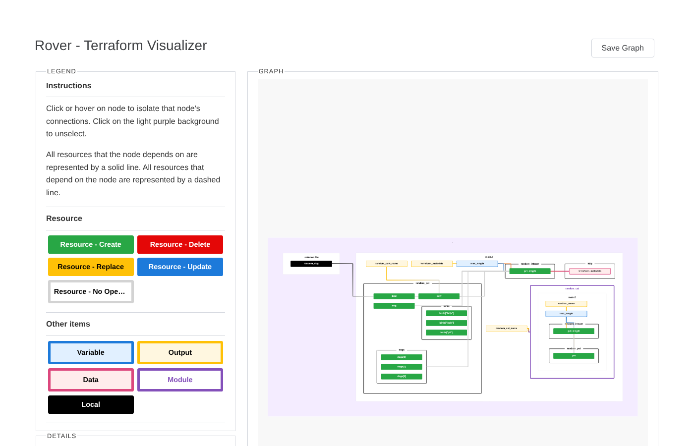
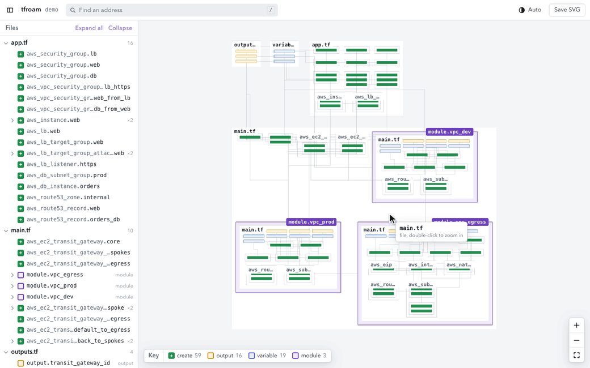
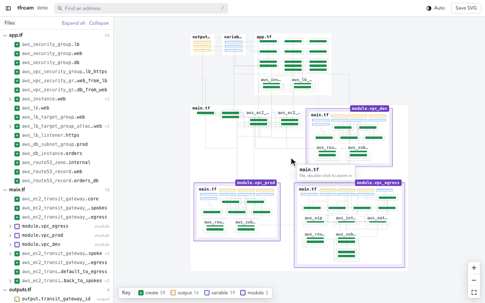
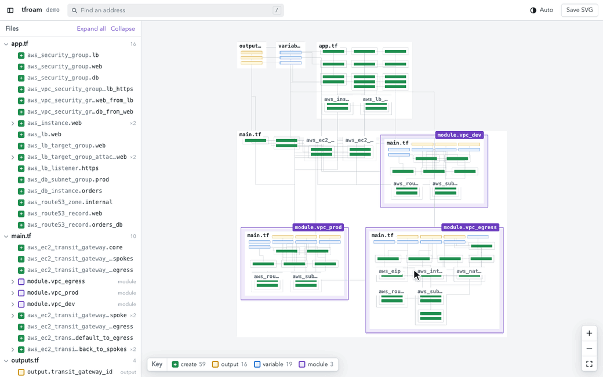

# Using tfroam

This guide covers running tfroam and reading what it shows. For the full list of flags, see
[Flags](../README.md#flags) in the README. For how the port differs from the Go original, see
[PORTING_NOTES.md](../PORTING_NOTES.md).

The command is `tfroam`. The examples use the demo configuration in
[`docs/demo`](demo), which plans without an AWS account, so you can follow along:

```
$ cd docs/demo
$ tfroam
```

Then open <http://localhost:9000>, or add `-open` and tfroam opens it for you.

## Contents

- [Choosing how to run it](#choosing-how-to-run-it)
- [Open plans automatically](#open-plans-automatically)
- [Reading the page](#reading-the-page)
- [Common tasks](#common-tasks)
- [Large plans](#large-plans)
- [Sharing a view](#sharing-a-view)
- [Keyboard](#keyboard)
- [What tfroam touches, and what it shows](#what-tfroam-touches-and-what-it-shows)
- [Troubleshooting](#troubleshooting)

## Choosing how to run it

tfroam needs two things: the plan (what Terraform will do) and the `.tf` files (where each block is
written). Choose how you supply the plan:

| You have | Run | Needs Terraform and cloud credentials? |
|---|---|---|
| A Terraform directory | `tfroam` in it, or `tfroam -workingDir path/to/dir` | Yes: tfroam runs `init` and `plan` |
| A saved binary plan | `tfroam -planPath plan.out` | Terraform yes (it runs `terraform show`, which needs the directory initialised), credentials no |
| A plan as JSON | `tfroam -planJSONPath plan.json` | No |

With a saved plan, run tfroam from the directory that holds the configuration, or point `-workingDir`
at it. Without the `.tf` files the graph still draws, but the file and line of each block are missing.

A JSON plan is the safest choice when the plan comes from somewhere else, such as a CI job. tfroam
then never runs Terraform:

```
$ terraform plan -out plan.out
$ terraform show -json plan.out > plan.json
$ tfroam -planJSONPath plan.json
```

When tfroam runs the plan itself, it passes Terraform's inputs through:

```
$ tfroam -tfVarsFile prod.tfvars -tfVar region=us-east-2
$ tfroam -tfBackendConfig prod.tfbackend -workspaceName prod
```

Your environment (`AWS_PROFILE`, `TF_VAR_*`, `TF_CLI_ARGS` and so on) reaches Terraform unchanged.
On shared remote state, add `-tfLock=false -tfRefresh=false` so tfroam does not take the state lock
or refresh state.

## Open plans automatically

Instead of running tfroam yourself after each plan, you can have every `terraform plan` open in tfroam.
This takes three pieces: a shell hook, a setting that turns it on, and optionally a list of where.

### 1. Install the shell hook

Terraform has no hook that runs after a plan, so tfroam wraps the `terraform` command (and `tofu`, if you
have it) in a small shell function. Add one line to your shell's startup file:

| Shell | File | Line |
|---|---|---|
| zsh | `~/.zshrc` | `eval "$(tfroam shell-init zsh)"` |
| bash | `~/.bashrc` | `eval "$(tfroam shell-init bash)"` |
| fish | `~/.config/fish/config.fish` | `tfroam shell-init fish \| source` |

Open a new terminal afterwards. The function sends every command except `plan` straight to Terraform,
untouched, so `apply`, `init`, `state` and the rest behave exactly as before. Run `tfroam shell-init zsh` on
its own to read the function before you add it.

### 2. Turn it on

The hook does nothing until a config file turns it on. There are two kinds:

- **Global**, for every Terraform root: `~/.config/tfroam/config.toml` (or `$XDG_CONFIG_HOME/tfroam/`, or the
  path in `$TFROAM_CONFIG`). Create a commented starter file with `tfroam config init --global`.
- **Local**, for one root and everything below it: `.tfroam.toml`. Create one in the current directory with
  `tfroam config init`. tfroam uses the nearest one, looking in the root and then its parents, so a single
  file at the top of a repository covers every root in it.

On everywhere:

```toml
# ~/.config/tfroam/config.toml
[auto]
enabled = true
```

Only in some places:

```toml
# ~/.config/tfroam/config.toml
[auto]
enabled = true
roots = ["~/work/infra", "~/lab/*/terraform"]   # directories (and everything below), or globs
exclude = ["~/work/infra/sandbox"]
```

Off in one repository even though the global file turns it on (or the other way round), with its own
view settings:

```toml
# ~/work/legacy/.tfroam.toml
[auto]
enabled = false
```

`roots` and `exclude` belong in the global file only. A local file's `[auto] enabled` always wins over the
global file, and `TFROAM_AUTO=0` or `TFROAM_AUTO=1` in front of a command wins over both:

```
$ TFROAM_AUTO=0 terraform plan     # just this once, no tfroam
```

### 3. Choose how the plan is shown

`[view]` works in both files (the local one overrides the global one key by key):

| Key | Values | Default |
|---|---|---|
| `mode` | `"serve"`: the live page, until you press Ctrl-C. `"page"`: write a static page to `.terraform/tfroam/page/` in the root, open it, and give you the prompt back at once | `"serve"` |
| `open_browser` | open the page in your browser | `true` |
| `ip_port` | where `serve` listens. `127.0.0.1:0` picks a free port, so plans in two terminals don't clash | `"127.0.0.1:0"` |
| `hide` | as `-hide`: any of `"locals"`, `"variables"`, `"outputs"` | `[]` |
| `show_sensitive` | as `-showSensitive` | `false` |

### What happens on `terraform plan`

1. tfroam reads the config for the root (the current directory, or `-chdir=DIR`).
2. If tfroam is on there, the plan runs exactly as you typed it, on your terminal, with one addition: unless
   you passed `-out`, the plan is saved to `.terraform/tfroam/last.tfplan` (readable only by you). Terraform
   then prints how to apply exactly that plan.
3. If the plan succeeds, tfroam opens it. In `serve` mode, press Ctrl-C when you are done to get your prompt
   back.
4. The command ends with Terraform's own exit code, so `-detailed-exitcode` still works.

tfroam stays out of the way, and the command goes straight to Terraform, when:

- the root has tfroam off, or no config turns it on;
- you asked for `-json` output or `-help`;
- the output is not a terminal (a pipe, a script, CI) or `TF_IN_AUTOMATION` is set, unless you set
  `TFROAM_AUTO=1`;
- a config file has a mistake: tfroam says so in one line and runs the plain command.

### Check what applies

`tfroam config` (or `tfroam config DIR`) shows the files that apply, whether tfroam is on and why, and the view
settings:

```
$ tfroam config
Root:          /Users/you/work/infra/prod
Global config: /Users/you/.config/tfroam/config.toml
Local config:  (none: no .tfroam.toml here or in a parent)
Auto:          on ([auto] enabled = true in /Users/you/.config/tfroam/config.toml (under [auto] roots))
View:          mode=serve open_browser=true ip_port=127.0.0.1:0 hide=locals,variables show_sensitive=false
```

### Without the hook

`tfroam plan [-chdir=DIR] [plan options]` does the same thing once, whatever the config says about `[auto]`
(the `[view]` settings still apply). It runs `terraform`; set `TFROAM_TF=tofu` to use OpenTofu.

## Reading the page



The page has three parts:

- **The list on the left** shows every file, then the blocks in it, in the order they are written.
  Each row shows what the plan does to that block. A block with `count` or `for_each` folds its
  instances underneath (`×2`).
- **The graph** fills the middle. Boxes nest: the directory, then each file, then each module call, then
  one box per resource type. The coloured bars are the single resources, data sources, outputs and
  variables.
- **The details panel** opens on the right when you select something.

The **key** along the bottom counts what the plan contains and explains the colours:

| Mark | Meaning |
|---|---|
| `+` green | created |
| `~` blue | updated in place |
| `±` amber | replaced (destroyed and created again) |
| `-` red | destroyed |
| white, outlined | in the plan, no change |
| grey | not in the plan's resource changes |
| gold outline | output |
| blue outline | variable |
| pink outline | data source |
| black | local value |
| purple box | module |

The key lists only what this plan contains, with a count for each.

**Lines** are dependencies. Once something is selected, solid lines lead to what it **depends on**,
dashed lines come from what **uses** it, and everything unrelated fades.

## Common tasks

### Find a resource by name

Press `/` and type any part of an address, such as a type (`aws_route`), a name (`orders`) or a module
(`module.vpc_dev`). Several words narrow the search: `vpc_prod route` matches addresses that contain
both. Matches are listed on the left and outlined in the graph. `Enter` opens the first match; the arrow
keys walk the list. `Esc` clears the search.



### See what depends on a resource before changing it

Select the resource, then open the **Connections** tab. *Depends on* lists what it needs; *Used by*
lists what breaks or changes if it goes. Every entry is a link, so you can walk the chain: select a VPC,
open one of its users, then that one's users.

In the graph, the same relationships are the solid lines (depends on) and dashed lines (used by).



### Check a value before you apply

Select the resource and use the tabs:

- **Config:** the arguments as written in the `.tf` file. References such as
  `aws_security_group.lb.id` are links to the resource they point at.
- **Current:** the values in state now. For something the plan creates, this says nothing exists yet.
- **Proposed:** the values after apply. Values marked **changed** differ from the current ones.
  `known after apply` means Terraform will only learn the value while applying, for example an ID.

Values Terraform marks as sensitive show as `Sensitive Value` (see
[what it shows](#what-tfroam-touches-and-what-it-shows)).

### Look at one module or file

Double-click a module's or file's box to zoom to it. Double-clicking a resource zooms in to it at a
size where its label can be read. The fit button in the corner (or `0` with the graph focused) brings
the whole graph back.



### Jump from the details panel to the graph

**Show in graph** moves the camera to the selected item. **Copy address** puts the address on the
clipboard, ready for `terraform state show` or `-target`.

## Large plans

A plan with hundreds of resources is readable, but it takes some technique:

- **Search instead of scanning.** Search outlines matches in the graph even when the graph is
  zoomed out.
- **Let the labels change with the zoom.** When the graph is zoomed out too far for its own text,
  files, modules and resource types get small fixed-size labels, so you can tell where you are.
  Zoom in (scroll where you want to look) for the full labels.
- **Hide the noise.** Almost every resource references a variable or a local, and those lines can
  bury the dependencies. Leave them out:

  ```
  $ tfroam -hide locals,variables            # resources, modules and outputs
  $ tfroam -hide locals,variables,outputs    # just resources and what depends on what
  ```

  `-hide` changes only the graph. The list on the left and the details still show everything.
- **Close the list** with the button at the top left to give the graph the full width.

## Sharing a view

The page runs on your machine only (`127.0.0.1`). To show it to someone else, write a file:

| Flag | Writes | Opens with |
|---|---|---|
| `-standalone true` | `tfroam.zip` (or `-zipFileName name`): the page with the plan data built in | Unzip it and open `index.html` in a browser. No server is needed. |
| `-genImage true` | `tfroam.svg` (or `-imagePath file.svg`): the whole graph as an image | Any browser or image viewer. Needs the `image` extra and a Chromium (see the README). |

**Save SVG** in the top bar downloads the same image from the running page.

Before you share either file, remember it is a copy of your plan. It contains resource names,
arguments and the planned values, which can include account IDs, IP ranges and hostnames. Sensitive
values stay hidden unless you ran tfroam with `-showSensitive`.

## Keyboard

| Key | Where | Does |
|---|---|---|
| `/` | anywhere | Focus the search box |
| `Enter` | search box | Open the first match |
| `↓` | search box | Move into the results |
| `Esc` | search box | Clear the search (press again to leave the box) |
| `Esc` | anywhere else | Clear the selection |
| `↑` `↓` | list | Move between rows |
| `→` `←` | list | Open or close a row |
| `Enter` / `Space` | list | Select the row |
| `←` `→` | details tabs | Switch tab |
| arrow keys | graph (focused) | Pan (`Shift` pans further) |
| `+` / `-` | graph (focused) | Zoom in or out |
| `0` | graph (focused) | Fit the whole graph |
| `Tab` | anywhere | Move between the list, search, graph, buttons and panel |

## What tfroam touches, and what it shows

**Your working directory.** Unless you pass a plan file, tfroam runs:

- `terraform init -input=false -upgrade=false`, which leaves `.terraform.lock.hcl` as it is. Pass
  `-tfUpgrade` to allow newer provider versions.
- `terraform workspace select`, when you pass `-workspaceName`.
- `terraform plan`, which takes the state lock and refreshes state, as a normal plan does. Turn either
  off with `-tfLock=false` or `-tfRefresh=false`.

tfroam never applies anything and never migrates state. If the backend configuration changed since
the last `init`, Terraform stops and you run `terraform init -migrate-state` (or `-reconfigure`)
yourself.

**The network.** The server listens on `127.0.0.1:9000` unless you choose another address with
`-ipPort`. It answers only requests addressed to `localhost`, `127.0.0.1`, `[::1]` or the address it is
bound to, which blocks DNS-rebinding tricks from other web pages. The page loads nothing from the
internet: no CDN, web fonts or analytics. Listening on all interfaces (`-ipPort 0.0.0.0:9000`, which
the Docker image does) makes the page reachable by anyone on your network.

**Sensitive values.** Anything Terraform marks as sensitive (resource attributes, state values,
outputs and `sensitive = true` variable defaults) shows as `Sensitive Value` on the page, in the zip
and in the API. `-showSensitive` turns that off, so use it only on your own machine.

## Troubleshooting

**It seems stuck after "Initializing Terraform...".** tfroam captures Terraform's output and shows it
only if a command fails. A first `init` that downloads providers can take a while. Add `-verbose` to
watch it.

**"Backend configuration changed".** Run `terraform init -migrate-state` or
`terraform init -reconfigure` yourself, then run tfroam again. tfroam does not migrate state for you.

**Terraform is not found.** tfroam uses `terraform` from your `PATH`. Point at a specific binary with
`-tfPath /path/to/terraform`, or use `-planJSONPath`, which needs no Terraform at all.

**The plan fails on credentials.** tfroam runs a normal `terraform plan`, so it needs the same
credentials. Either set them (`AWS_PROFILE=...`), or make the plan elsewhere and pass it with
`-planJSONPath`.

**The state is locked.** Someone else, or a CI job, holds the lock. Use `-tfLock=false` (and, on
shared state, `-tfRefresh=false`).

**`terraform plan` does not open tfroam.** Run `tfroam config`: it says whether tfroam is on for this
directory and which file decided. If it is on, check that the hook is loaded (`type terraform` should say
it is a shell function; open a new terminal after editing your startup file), and that the plan's output
goes to the terminal, not a pipe.

**A config file has an error.** tfroam names the file and the key (unknown keys are reported, since they
are usually typos) and runs the plain Terraform command meanwhile.

**Port 9000 is already in use.** Choose another port: `tfroam -ipPort 127.0.0.1:9001`.

**`-genImage` fails with a Playwright or Chromium error.** Add Playwright (`pipx inject tfroam playwright`,
or `pip install '.[image]'` in a virtualenv) and a browser (`playwright install chromium`), or set
`TFROAM_BROWSER_PATH` to an existing Chrome or Chromium.

**`tfroam: command not found`.** The command is not on your `PATH`; see
[Install](../README.md#install). With pipx, run `pipx ensurepath` and open a new terminal.

**The page says "This plan has nothing to draw".** The plan has no resources, data sources, outputs or
variables. Check that `-workingDir` points at the configuration you meant.

**A block has no file and line in the details.** tfroam could not find it in the `.tf` files. This
happens when the plan comes from another checkout, or when the block is written in a `.tf.json` file,
which tfroam does not read.

**Terraform Cloud flags (`-tfcOrg`, `-tfcWorkspace`, `-tfcNewRun`) give an error.** They are accepted
for compatibility with the Go version but not supported. Download the run's plan as JSON and use
`-planJSONPath`.
